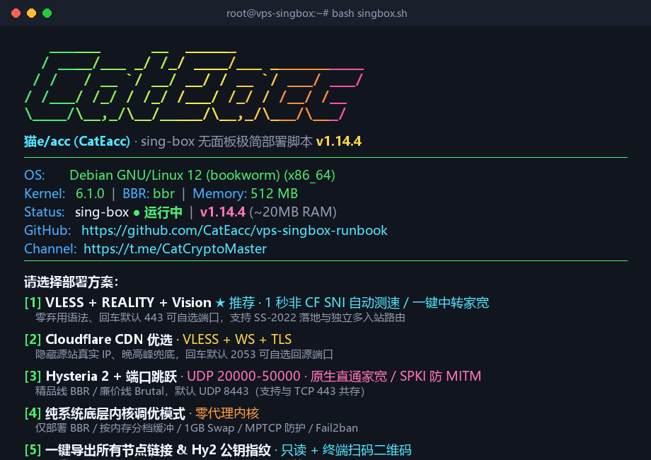

# 生产级 sing-box 部署与调优实战手册（sing-box v1.14.4 零弃用语法）

[](https://github.com/SagerNet/sing-box/releases)
[](#)
[](LICENSE)
[](https://t.me/CatCryptoMaster)

> **仓库地址**：`github.com/CatEacc/vps-singbox-runbook`  
> **系列矩阵**：[vps-xray-runbook](https://github.com/CatEacc/vps-xray-runbook)（Xray + 3x-ui 面板版） · [vps-clash-runbook](https://github.com/CatEacc/vps-clash-runbook)（Mihomo 客户端版） · **vps-singbox-runbook**（sing-box 无面板单内核全栈版）

---

## 小白一键执行（四套方案交互菜单，单进程极低内存）

新机以 `root` 执行下方命令，按提示选 `1`～`4`（与 `vps-xray-runbook` 四方案完全对齐，**无面板常驻仅 ~20MB 内存**，启动前自动执行 `sing-box check` 强校验）：

```bash
bash <(curl -fsSL https://raw.githubusercontent.com/CatEacc/vps-singbox-runbook/main/singbox.sh)
```



* **方案 1：`VLESS + REALITY + Vision`**（回车默认 `443` 可自选端口，内置 **9 大地区 100% 纯本土 X25519 SNI 自动测速 + 全球 5 站兜底池 + 选后自动实时四重复检**，防套 CF / 防国内 CDN / 防被墙；**支持直接粘贴 `ss://` 链接自动解析，或填后端家宽机 SSH 账密全自动远程部署落地并加白名单完成中转对接**）
* **方案 2：`Cloudflare CDN 优选`**（`VLESS + WS + TLS`，默认 `2053` 可自选回源端口）
* **方案 3：`Hysteria 2 + 20000-50000 端口跳跃`**（默认 `UDP 8443` 错开 `TCP 443`，**单进程原生直通后端家宽，无需本地 SOCKS5 桥接、省百兆内存**）
* **方案 4：`纯系统底层内核调优模式`**（BBR + FQ、按内存分档网络缓冲区、1GB Swap、禁 MPTCP、Fail2ban、Journald 50M 收敛）

---

## 一、为什么单独做 `sing-box v1.14.4` 零弃用版？

`sing-box` 在 **`v1.11` → `v1.14`** 期间进行了大幅架构重构，网上大量旧教程在 `v1.14.4` 上会直接报错或刷屏弃用警告。本仓库所有服务端与客户端 JSON 均已通过官方 **`sing-box v1.14.4 check -c`** 零报错、零警告验收：

| 核心变更点 | 已废弃旧写法（会报错/警告） | 本仓库 `v1.14.4` 规范写法 |
| :--- | :--- | :--- |
| **路由动作** | `"outbound": "block"` / 入站 `"sniff": true` | 显式 **`"action": "sniff"`** / **`"hijack-dns"`** / **`"reject"`** / **`"route"`** |
| **DNS 配置** | `address: "https://..."`（`v1.14` 已彻底移除） | 新版 typed 对象：`{"type": "https", "server": "1.1.1.1"}` / `{"type": "fakeip"}` |
| **规则集下载** | `download_detour`（`v1.14` 起废弃） | 显式定义 `http_clients` 并在 `rule_set` 中引用 `"http_client"` |
| **地理规则** | 旧版 `geoip.dat` / `geosite.dat` | 统一采用官方二进制 **`.srs`** 规则集（`format: "binary"`） |
| **链式中转** | Clash 的 `dialer-proxy` | 服务端与客户端统一使用 **`"detour"`** |

---

## 二、客户端开箱即用模板（[`client.json`](client.json)）

本仓库附带一份已通过 `sing-box v1.14.4 check -c` 校验的完整客户端配置 [`client.json`](client.json)（适配 Apple SFI/SFM、Android SFA、Windows/Linux）：

- **零泄露 `Fake-IP` DNS**：国内域名走 `dns-direct`（阿里 DoH），海外走 `dns-fakeip` + `dns-remote`（CF DoH），`strategy: "ipv4_only"` 杜绝脏 IPv6 污染住宅画像；
- **`detour` 链式中转家宽**：`Residential-ISP-Landing`（SS-2022）通过 `"detour": "🚀 前置优化机"` 经由前置优化机连入，AI（OpenAI / Claude / Gemini）与流媒体（Netflix / TikTok）精准走纯净家宽出口；
- **安全回环监听**：本地混合代理仅监听 `127.0.0.1:7890`，绝不向公网暴露端口。

---

## 三、方案 2：Cloudflare CDN 优选小白配置教学（`VLESS + WS + TLS`）

若你选择了脚本中的 **方案 2（Cloudflare CDN 优选，默认 `2053` 端口）**，跑完脚本后按下面 5 步在 Cloudflare 后台点完即可连通：

1. **添加 DNS 解析并开启小黄云（Proxied）**：
   * 进入 Cloudflare 后台 → **DNS → Records → Add record**：
   * Type 选 **`A`**，Name 填子域（如 `cf`，对应 `cf.example.com`），IPv4 address 填你的 **VPS 真实 IP**，**Proxy status 必须打开橙色云朵（Proxied）**。
2. **设置 SSL/TLS 加密模式（最容易踩坑）**：
   * 进入 **SSL/TLS → Overview**，将加密模式设为 **`Full`（完全）**。
   * ⚠️ 脚本默认签发自签证书，**切勿选 `Flexible`**（会连不上），也**不要选 `Full (Strict)`**（会报 `526`），除非你自行替换了 `acme.sh` 或 Cloudflare Origin 正规证书。
3. **打开 WebSockets 与检查端口**：
   * 进入 **Network（网络）**，确认 **WebSockets** 为开启状态（本方案采用 `VLESS + WS + TLS`）。
   * Cloudflare 免费版支持代理的 HTTPS 端口：`443`、`2053`（默认）、`2083`、`2087`、`2096`、`8443`；请确认云厂商安全组已放行对应 TCP 端口。
4. **客户端导入与替换优选 IP / 优选域名**：
   * 直接导入脚本输出的 `vless://` 链接即可使用默认 CF 线路；
   * 如需优选提速：**仅把节点里的「地址 (Address / server)」改成优选 IP 或优选域名**，**`Host` 和 `SNI` 必须保持为你的 CF 域名不变**。
5. **常见报错速查**：
   * **`521`**：云厂商安全组未放行 TCP `2053`（或自选端口），或 `sing-box` 未运行；
   * **`522`**：DNS `A` 记录 IP 填错或源站端口不匹配；
   * **`525` / `526`**：Cloudflare SSL/TLS 模式选错，改为 **`Full`** 即可；
   * **导入后连不上**：检查是否误把 `Host` / `SNI` 改成了优选 IP（必须保持为你的域名）。

---

## 四、常用运维命令

```bash
# 校验配置语法（零报错无输出即通过）
sing-box check -c /etc/sing-box/config.json

# 查看服务状态与实时日志
systemctl status sing-box
journalctl -u sing-box -n 50 --no-pager

# 重启生效
systemctl restart sing-box
```

---

> **免责声明**：本项目及脚本仅供 Linux 服务器性能调优、网络协议研究与合规技术学习使用，请遵守当地法律法规。
